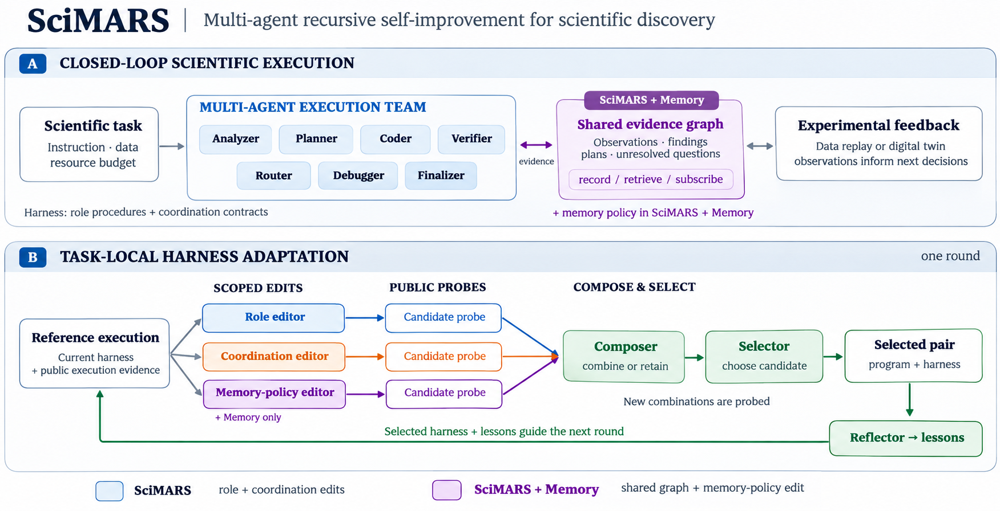

# SciMARS: Multi-Agent Recursive Self-Improvement for Closed-Loop Scientific Discovery

[Watch video](media/SciMARS_film.mp4) · [Paper (Arxiv)](https://arxiv.org/abs/2611.12552) · [Cite SciMARS](#citation) · [Download BibTeX](CITATION.bib)

**Adapt how a multi-agent team works as task evidence changes.**

SciMARS is a framework for recursive, task-local adaptation of multi-agent harnesses in closed-loop scientific discovery. Teams coordinate analysis, experimental design, and verification, but they can lose observations, repeat work, and retain ineffective procedures. SciMARS addresses these problems through separate role and coordination editors. SciMARS + Memory adds a shared evidence graph and a third editor for the memory policy.

The paper studies the discovery interface through experimental-data replay and a digital twin, with scientific programming and interactive tasks as complementary settings. This does not involve new physical wet-lab execution. This repository provides reusable harness components, an AppWorld adapter, and local scientific Python examples. Connect your existing team through an execution callback to use the adaptation loop in your own environment.



[Connect your team](docs/custom_teams.md) · [AppWorld quickstart](#appworld-quickstart) · [Memory](docs/memory.md) · [Design](docs/architecture.md) · [Configuration and evaluation](docs/reproduction.md) · [Your own Python task](docs/custom_tasks.md)

## Connect your existing team

Install from a checkout using the first installation block below through `python scripts/fetch_dependencies.py`; AppWorld installation is optional for custom teams. Then run:

```bash
python examples/existing_team.py --output runs/my-team-smoke
```

This no-credential smoke test uses scripted editors and real Python execution. Replace its executor callback with your team and supply your existing harness to `optimize_team`. The optimizer owns proposal validation, probes, composition, current-round selection, and verified execution reuse. Your callback owns environment isolation, tool limits, and applying role instructions and handoff contracts. See the [integration contract and supported surface](docs/custom_teams.md).

## AppWorld quickstart

Use Linux and Python 3.11 for the AppWorld environment. Install from a checkout:

```bash
git clone https://github.com/WeiminWu2000/SciMARS.git
cd SciMARS
python3.11 -m venv .venv
source .venv/bin/activate
pip install -e '.[test]'
python scripts/fetch_dependencies.py

python3.11 -m venv .venv-appworld
.venv-appworld/bin/pip install 'appworld==0.1.3.post1'
.venv-appworld/bin/appworld install
.venv-appworld/bin/appworld download data --root appworld_data
```

AppWorld's code and data are obtained from its own distribution and retain their own terms. See the [AppWorld project](https://github.com/StonyBrookNLP/appworld) for its setup requirements. This adapter targets package `0.1.3.post1` and data `0.1.0`.

Check a development task without credentials or model calls:

```bash
mah2 appworld --task 4ec8de5_1 --output runs/appworld-demo --dry-run
```

The check validates configuration and local paths; it does not start the AppWorld worker. To run the team:

```bash
export OPENROUTER_API_KEY_FILE=/path/to/private/openrouter.key
mah2 appworld --task 4ec8de5_1 --method harness2 \
  --output runs/appworld-demo --budget 1.0 --execute --grade
```

`--execute` permits paid calls. `--grade` runs AppWorld's official evaluator **after** final commitment. Without `--grade`, official success remains unset. Output directories must be new; the runner does not overwrite prior attempts.

The AppWorld configuration uses `z-ai/glm-5.3-flashx`, two outer rounds, and one shared API allowance per task. These are recorded settings, not a promise of current endpoint availability. Check your provider and rates before using a different configuration. `--appworld-root`, `--appworld-python`, and `--config` support other installation locations.

## Five settings, one execution team

| AppWorld `--method` | What it does |
|---|---|
| `base` | Runs the fixed seven-role team once, without outer revisions. |
| `harness2` — SciMARS | Uses separate role and coordination editors, probes their proposals, and composes a successor. |
| `integrate` | Integrated workflow search: the released MASS revision and selection procedure with the same team executor (alias `mass`). |
| `memory` — Multi-Agent + Memory | Adds a shared evidence graph to the base team. Graph contents grow, while the memory policy stays fixed. |
| `memory_harness2` — SciMARS + Memory | Adds the graph and a third editor that adapts the memory policy alongside roles and coordination. |

## Shared memory and memory-policy adaptation

The released memory integration targets AppWorld.

The shared graph retains observations, agent notes, and links to their sources. Agents receive retrieved evidence and updates through their role's memory policy. The policy controls what each role records, what it retrieves, and which updates it receives.

**Memory contents and memory policy are distinct.** In `memory`, agents add evidence under a fixed policy. In `memory_harness2`, a separate LLM editor proposes policy changes; it does not rewrite host-recorded observations or measurement values. The three editors can use the same underlying language model. The memory-policy editor is a separate call, not a requirement for another model.

Each candidate starts with a fresh graph or its own copy of an optional store built from disjoint development tasks. Evaluation-task writes do not transfer to later tasks. To use memory without building a store:

```bash
mah2 appworld --task 1150ed6_2 --method memory_harness2 \
  --output runs/scimars-memory-demo --budget 1.0 --execute --grade
```

Use `--method memory` for the fixed-policy setting. See [the memory guide](docs/memory.md) for the optional store and policy schema.

All five settings use the same team executor. The per-task allowance includes editing, probes, retries, and selection. `config/appworld.json` controls the shared runtime options; `--paper-settings` disables the later runtime fixes to select the recorded configuration. Keep these options, task information, model, and resource limits matched when comparing settings.

`integrate` requires `python scripts/fetch_dependencies.py --include-mass`. Its source is obtained separately and is not redistributed here. The AppWorld adapter runs Python/API interactions through the shared team; it does not require the Qwen-code executor used by the local-file MASS adapter. This is a workflow-search adaptation, not the full trained MASS system. See [the comparison protocol](docs/reproduction.md).

## How it works

1. **Execute the reference team.** Seven logical roles—analyzer, planner, coder, verifier, router, debugger, and finalizer—produce task evidence under the current harness.
2. **Propose separate changes.** Role and coordination editors work from the same reference. SciMARS + Memory adds a memory-policy editor. Each proposal stays within its editable component.
3. **Probe and compose.** Execute candidates in isolated states. Use their public traces to compose a successor. Probe a new combination; reuse an execution only when the same-round identity checks pass.
4. **Select and reflect.** Select a current-round program–harness pair using public evidence. Carry the selected harness and lessons into the next round. Earlier unselected programs cannot re-enter selection.
5. **Commit, then evaluate.** AppWorld's official evaluator grades the final committed state. Hidden scores do not enter proposal or selection prompts.

Recursion means repeating this task-local adaptation loop. The optimizer remains separate from the execution team and does not rewrite itself. A selected successor can retain the reference or adopt supported component changes; composition does not require accepting every proposal. Public probes guide selection but do not guarantee improvement on the official task metric.

## Settings and local artifacts

`config/appworld.json` contains the model, budget allocation, team step limit, and selection policy. `config/appworld_tasks.json` lists Music and Finance task identifiers for trying the adapter. These are researcher-defined task categories, not AppWorld's official app domains.

Each new run saves its configuration, source hashes, API accounting, public interaction traces, candidate decisions, and final commitment. AppWorld stores candidate world states under its own experiment directory. Keep both directories to inspect or evaluate a run.

## Try the loop without API calls

The small local-file demo uses scripted editors and real sandboxed Python execution. It requires Linux and `bubblewrap` (`bwrap`), but no AppWorld data or model credentials:

```bash
mah2 demo --output runs/demo --rounds 2
mah2 report --run runs/demo
```

For your own scientific Python tasks, use `mah2 init`, `mah2 run`, and `mah2 report`. Follow the [task guide](docs/custom_tasks.md) and [local-file setup](docs/setup.md). The AppWorld and local-file adapters share the harness schema and recursion controller, but use different execution environments.

## Development

```bash
pip install -e '.[test]'
python scripts/fetch_dependencies.py --include-mass
python -m unittest discover -s tests -v
python scripts/check_release.py
```

Tests use synthetic fixtures and mocked model calls. See [CONTRIBUTING.md](CONTRIBUTING.md) and [SECURITY.md](SECURITY.md).

## Citation

If you use SciMARS, please cite our paper:

```bibtex
@misc{wu2026scimars,
  title        = {{SciMARS}: Multi-Agent Recursive Self-Improvement for Closed-Loop Scientific Discovery},
  author       = {Wu, Weimin and Liu, Han},
  year         = {arXiv preprint arXiv:2611.12552},
  howpublished = {preprint},
  url          = {https://arxiv.org/abs/2611.12552}
}
```

## Attribution and license

The method builds on [Harness²: Recursive Agent Harnessing for an Open World](https://arxiv.org/abs/2610.14224) (Xu et al., 2026; [code](https://github.com/google-research/harness2)), with prompt components from [DS-STAR](https://github.com/google-research/ds-star), an optional [MASS](https://github.com/SakanaAI/mass) workflow-search adapter, and an execution adapter for [AppWorld](https://github.com/StonyBrookNLP/appworld).

Our code is Apache-2.0. Dependencies retain their own terms; see [NOTICE](NOTICE), [CITATION.cff](CITATION.cff), and [AppWorld source provenance](provenance/appworld.json). Benchmark data, upstream source checkouts, credentials, and generated trajectories are not included. This is an independent project, not an officially supported Google product.

## References

```bibtex
@article{xu2026harness2,
  title   = {Harness$^2$: Recursive Agent Harnessing for an Open World},
  author  = {Xu, Ruiyao and Chen, Yanfei and CuiZhu, Zhongying and Dalvi Mishra, Bhavana and Ming, Yifei and Yu, Han and Han, Rujun and Lee, Chen-Yu and Pfister, Tomas},
  journal = {arXiv preprint arXiv:2610.14224},
  year    = {2026},
  url     = {https://arxiv.org/abs/2610.14224}
}
```
